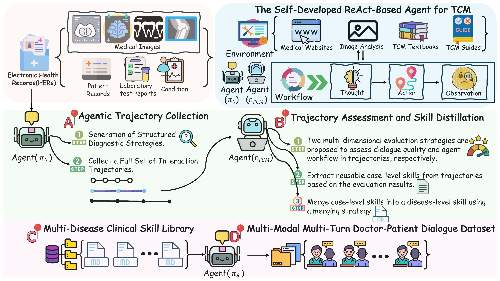
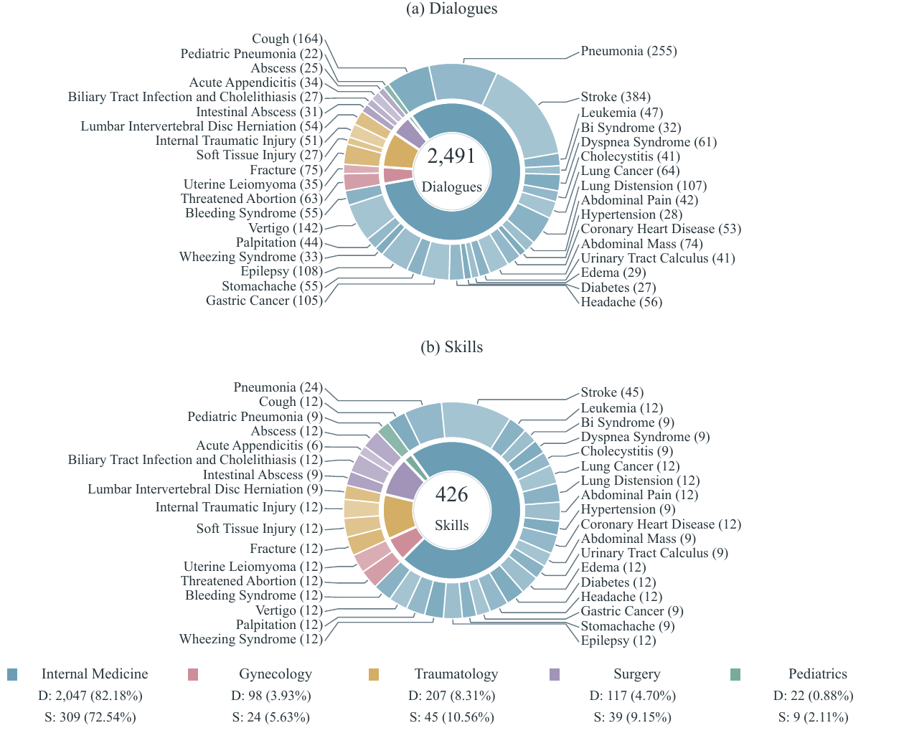
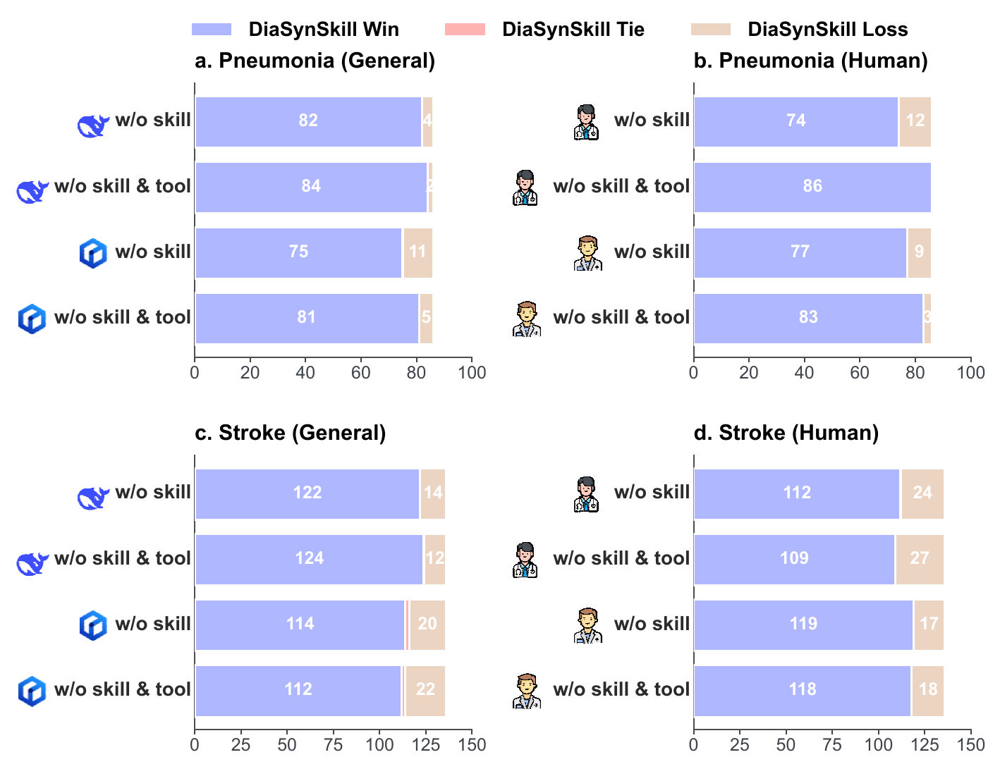
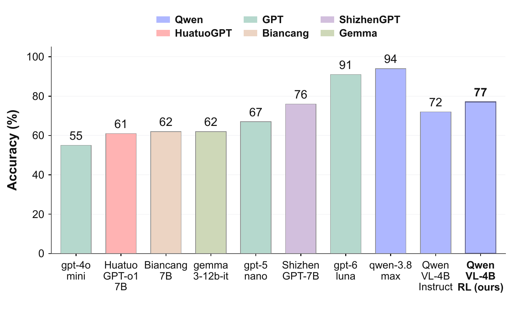
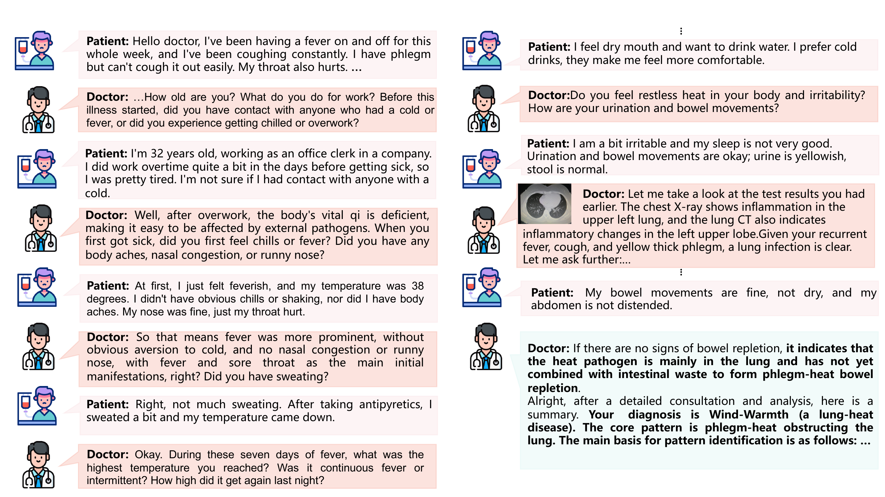

<h1 align="center">DiaSynSkill: Skill-Guided Synthesis of Multimodal Diagnostic Dialogues</h1>

<p align="center"><strong>Learning reusable diagnostic skills from clinical trajectories</strong></p>

<p align="center">
  <a href="#overview">Overview</a> ·
  <a href="#method">Method</a> ·
  <a href="#dataset">Dataset</a> ·
  <a href="#experiments">Experiments</a> ·
  <a href="#examples">Examples</a> ·
  <a href="#setup">Setup</a>
</p>

<p align="center"><strong>2,491 dialogues &nbsp; | &nbsp; 426 skills &nbsp; | &nbsp; 35 diseases &nbsp; | &nbsp; 5 departments</strong></p>

<a id="overview"></a>

## 📖 Overview

**DiaSynSkill** is a skill-guided framework for synthesizing multi-turn diagnostic dialogues from multimodal real-world Traditional Chinese Medicine (TCM) clinical cases. Rather than generating conversations directly from model priors, DiaSynSkill extracts transferable diagnostic skills from agentic reasoning trajectories and uses them as procedural guidance for dialogue synthesis.

The framework combines **Agentic Trajectory Collection**, **Trajectory Assessment and Skill Distillation**, a **Multi-Disease Clinical Skill Library**, and a **Multimodal Multi-Turn Doctor–Patient Dialogue Dataset**. The resulting skills encode information acquisition patterns, syndrome differentiation logic, contrastive diagnosis strategies, and evidence-grounded generation constraints.

<a id="method"></a>

## 🛠️ Method

<p align="center">
  <a href="assets/framework.pdf"></a>
</p>
<p align="center"><em>Overview of the DiaSynSkill framework.</em></p>

DiaSynSkill follows a four-component workflow:

1. **Agentic trajectory collection**: a ReAct-style TCM agent uses clinical records and external medical tools to generate structured diagnostic strategies and interaction trajectories.
2. **Trajectory assessment and skill distillation**: a TCM practitioner agent evaluates trajectories from multiple dimensions and abstracts reusable case-level diagnostic skills.
3. **Multi-disease skill library construction**: case-level skills are aligned and consolidated into disease-level skills covering recurrent inquiry routines, syndrome reasoning, differential diagnosis, and evidence constraints.
4. **Skill-guided dialogue synthesis**: the disease-level skill is retrieved as a structured prior for generating multimodal, multi-turn doctor-patient dialogues.

The released implementation is organized in [`eval/`](eval/), including the inference orchestration, experience learning, skill construction, tool registration, and context utilities.

<a id="dataset"></a>

## 📚 Dataset

DiaSynSkill generates two complementary resources:

- **Skill Library**: 426 diagnostic skills organized across 35 TCM diseases.
- **Multimodal Multi-Turn Doctor–Patient Dialogue Dataset**: 2,491 dialogue samples spanning five TCM departments.

<p align="center">
  <a href="assets/disease-sunburst-leader-compact-combined.pdf"></a>
</p>
<p align="center"><em>Disease and department distribution of the synthesized resources.</em></p>

The repository also includes representative diagnostic skill documents in [`examples/skills/`](examples/skills/) and generated dialogue examples in [`examples/dialogues/`](examples/dialogues/).

<a id="experiments"></a>

## 📊 Experiments

We evaluate DiaSynSkill with general multi-dimensional dialogue quality metrics, TCM-specific diagnostic metrics, pairwise comparison, and downstream diagnostic response modeling. The evaluation compares DiaSynSkill with strong MLLM baselines and two ablations that remove the induced skills and tool-supported trajectory process.

### Pairwise comparison

<p align="center">
  <a href="assets/pairwise-comparison.pdf"></a>
</p>
<p align="center"><em>Pairwise comparison results under general LLM-based and clinical practitioner evaluation.</em></p>

DiaSynSkill receives the highest preference across pneumonia and stroke comparisons, with consistent trends from both automated judges and clinical TCM practitioners.

### Automatic evaluation

The following scores are from DeepSeek-V3.2 evaluation. **General** aggregates factuality, conciseness, fluency, and naturalness; **TCM** aggregates clinical factuality, diagnostic expertise, dialogue integrity, and communication quality.

| Method | Pneumonia: General | Pneumonia: TCM | Stroke: General | Stroke: TCM |
|:--|--:|--:|--:|--:|
| Claude-Haiku-4.5 | 88.35 | 71.12 | 82.85 | 69.02 |
| Gemini-3.5-Flash | 83.35 | 67.30 | 83.95 | 71.96 |
| GPT-5.6-Luna | 83.25 | 69.08 | 79.80 | 68.65 |
| MiniMax-M3 | 84.05 | 72.22 | 84.95 | 72.82 |
| Qwen3.6-35B-A3B | 77.85 | 65.53 | 80.85 | 65.34 |
| Qwen3.7-Plus | 84.45 | 67.81 | 79.10 | 70.91 |
| w/o skill & tool | 92.45 | 84.37 | 90.80 | 89.28 |
| w/o skill | 92.95 | 90.51 | 92.25 | 89.86 |
| **DiaSynSkill** | **93.65** | **91.54** | **93.60** | **91.01** |

Compared with direct prompting of advanced MLLMs, DiaSynSkill shows its largest gains on diagnostic expertise, dialogue integrity, and communication quality.

### Downstream diagnostic response modeling

<p align="center">
  <a href="assets/tcm_agent_accuracy_v4.pdf"></a>
</p>
<p align="center"><em>Accuracy comparison for TCM diagnostic response models.</em></p>

Evaluated on **100 TCM cases from physician licensing examinations** using the multi-agent diagnostic framework, the RL-trained model improves over its instruction-tuned baseline:

| Model | Diagnosis accuracy |
|:--|--:|
| Qwen-VL-4B-Instruct | 72% |
| **Qwen-VL-4B-RL (ours)** | **77% (+5 percentage points)** |

<a id="examples"></a>

## 🧩 Examples

<p align="center">
  <a href="assets/dialogue-example.pdf"></a>
</p>
<p align="center"><em>Examples of multimodal doctor-patient diagnostic dialogues synthesized by DiaSynSkill.</em></p>

<details>
<summary><strong>Browse 10 diagnostic inquiry skills</strong></summary>

| Skill | Topic |
|-------|-------|
| [Stroke](examples/skills/skill_01_stroke.md) | Qi-Yin deficiency with blood stasis |
| [Pneumonia](examples/skills/skill_02_pneumonia.md) | Phlegm-heat in the lung |
| [Diabetes](examples/skills/skill_03_diabetes.md) | Xiaoke with comorbidity |
| [Acute abdomen](examples/skills/skill_04_acute_abdomen.md) | Cholecystitis and appendicitis |
| [Chronic bronchitis](examples/skills/skill_05_bronchitis.md) | Phlegm-dampness |
| [Headache](examples/skills/skill_06_headache.md) | Intracranial mass |
| [Ovarian tumor](examples/skills/skill_07_ovarian_tumor.md) | Qi stagnation and blood stasis |
| [Trauma](examples/skills/skill_08_trauma.md) | Open wounds and fractures |
| [Parotid mass](examples/skills/skill_09_parotid_mass.md) | Phlegm nucleus |
| [Mycoplasma pneumonia](examples/skills/skill_10_mycoplasma.md) | Atypical cough |

</details>

<details>
<summary><strong>Browse 10 generated dialogue examples</strong></summary>

| Dialogue | Topic |
|----------|-------|
| [Headache](examples/dialogues/dialogue_01_headache.md) | Intracranial mass |
| [Cholecystitis](examples/dialogues/dialogue_02_cholecystitis.md) | Acute abdominal pain |
| [Pneumonia and cancer](examples/dialogues/dialogue_03_pneumonia_cancer.md) | Respiratory disease with comorbidity |
| [Stroke](examples/dialogues/dialogue_04_stroke.md) | Neurological deficits |
| [Appendicitis](examples/dialogues/dialogue_05_appendicitis.md) | Acute abdominal pain |
| [Diabetes](examples/dialogues/dialogue_06_diabetes.md) | Xiaoke with comorbidity |
| [Chronic bronchitis](examples/dialogues/dialogue_07_bronchitis.md) | Acute exacerbation |
| [Ovarian tumor](examples/dialogues/dialogue_08_ovarian_tumor.md) | Abdominal mass |
| [Trauma](examples/dialogues/dialogue_09_trauma.md) | Hand injury |
| [Mycoplasma pneumonia](examples/dialogues/dialogue_10_mycoplasma.md) | Persistent cough |

</details>

## 📁 Repository Structure

```text
.
├── assets/                         # Paper figures and experiment plots
├── eval/                           # Inference and skill construction code
│   ├── infer_api.py
│   ├── requirements.txt
│   ├── engine/
│   ├── learning/
│   ├── tools/
│   └── utils/
├── examples/
│   ├── skills/
│   └── dialogues/
└── README.md
```

<a id="setup"></a>

## ⚙️ Environment and API Configuration

Install the Python dependencies with:

```bash
python -m pip install -r eval/requirements.txt
```

The experience-generation client accepts an OpenAI-compatible chat completion service through environment variables:

```bash
export EXPERIENCE_MODEL_NAME="your-model-name"
export EXPERIENCE_API_KEY="your-api-key"
export EXPERIENCE_END_POINT="https://your-endpoint"
```

See [`eval/learning/llm_client.py`](eval/learning/llm_client.py) for request construction and [`eval/infer_api.py`](eval/infer_api.py) for inference and skill-accumulation entry points.
